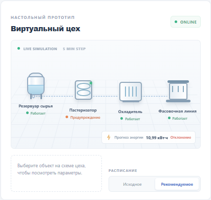

# Интеллектуальное управление ресурсами молочного цеха

Учебный настольный прототип лабораторной работы 11. Выбран продукт — пастеризованное молоко; веб-панель показывает прогноз электроэнергии и воды на следующий интервал, динамику ресурсов, сравнение моделей, предупреждения и работу виртуального участка. Это система поддержки решений: реальные исполнительные механизмы не подключены.

## Запуск

Требуется Node.js 20 или новее. Из этой папки выполните:

```powershell
npm install
npm run dev
```

Откройте адрес Vite, напечатанный в терминале (обычно `http://localhost:5173`). API доступно на `http://localhost:3001/api/health`. Для production-сборки выполните `npm run build`; тесты — `npm test`; экспорт датасета в CSV — `npm run export:data`.

## Производственный процесс и ограничения

Учебная цепочка: резервуар молока → пастеризатор → охладитель → фасовочная линия. Контролируются сырьё, вода, электроэнергия, выпуск, температуры, давление, загрузка, режим производства/ожидания/мойки и простой. Для демонстрации приняты технологические границы: входное молоко 4–7 °C, пастеризация 71–73 °C и загрузка линии до 90%. Ограничения не ослабляются ради снижения затрат. Все воздействия и расписания существуют только в симуляции.

## Данные и воспроизводимость

`server/simulator.js` генерирует ровно 5 000 последовательных наблюдений с шагом 5 минут и фиксированным seed `20251111`. Ряд синтетический, с шумом, режимами работы и внедрённым восьмиинтервальным скачком энергопотребления. Почасовой расход сырья (`milk_flow`, л/ч) переводится в объём интервала при расчёте выпуска. Данные не являются измерениями предприятия.

Цели прогноза — электроэнергия и вода следующего интервала; признаки берутся только из текущего или предыдущих наблюдений. Индексы целевых интервалов разделены хронологически: обучение — 1–3 499, валидация — 3 500–4 249, тест — 4 250–4 999. Перемешивание не применяется. Преобразование признаков обучается только на обучающем участке. Перед обучением автоматически проверяются обязательные поля, пропуски, временной порядок, дубликаты меток и 5-минутный шаг.

## Модели и оценка

Реализованы на JavaScript без библиотек машинного обучения:

* наивный прогноз — текущее потребление как прогноз следующего интервала;
* линейная регрессия — МНК с малой L2-регуляризацией;
* случайный лес — 12 регрессионных деревьев, глубина 4, bootstrap-выборки;
* обучаемая одномерная CNN — окно из 12 наблюдений, 4 канала (энергия, вода, загрузка, температура), 5 фильтров, до 28 эпох с ранней остановкой (patience 5) по валидационной ошибке.

Для всех моделей и обеих целей выводятся MAE, RMSE и R² на одних и тех же временных частях. Порог предупреждения об отклонении энергии — 95-й процентиль абсолютных ошибок случайного леса на валидационной части; предупреждение возникает после трёх превышений подряд. В тестовый период внедрено размеченное отклонение, поэтому также рассчитываются precision, recall и задержка обнаружения. Срабатывание означает необычное поведение, но не устанавливает неисправность.

## Рекомендации и сценарии

Исходный и рекомендуемый варианты сравниваются при одинаковом сценарии и, если возможно, плановом выпуске. Рекомендация выбирает менее затратное историческое производственное окно и рассчитывает потребление по наблюдённым интервалам обучающей части, без фиксированного коэффициента экономии. Двухлинейный вариант упрощённо использует исторический профиль одной линии. Прототип проверяет повышенный спрос, ограничение сырья, простой линии и избыточный расход. Если план физически невыполним, это явно отображается; недовыпуск не выдаётся за экономию. Расчёт стоимости использует учебные тарифы: 30 тг/кВт·ч и 0,02 тг/л воды. Это результат симуляции, не доказанная экономия на реальном предприятии.

Виртуальный цех — интерактивная настольная схема, не VR-сцена Unity/Unreal. Выберите оборудование для просмотра параметров, переключайте расписания и используйте сценарий из панели «Сценарии».

## Состав проекта

* `server/simulator.js` — генерация набора данных;
* `server/models.js` — обучение и метрики моделей;
* `server/index.js` — Node.js API и расчёт планов;
* `src/main.jsx`, `src/styles.css` — React-интерфейс и адаптивная схема цеха.

Для реального применения потребуются обезличенные данные, проверка технологических карт и модели специалистами, валидация на будущих периодах, обработка пропусков/дубликатов, оценка точности обнаружения, защита API и отдельное согласование любых управляющих действий.

## Отчёт по лабораторной работе 11

### 1. Производственный процесс

Выбран продукт — пастеризованное молоко. Укрупнённая цепочка: приёмка и хранение молока в резервуаре → тепловая обработка в пастеризаторе → охлаждение → фасовка. Учитываются молочное сырьё, электроэнергия и вода, в том числе на мойку. Выпуск и фасовка отражены в объёме готового продукта; отдельный расход упаковки в этой учебной модели не рассчитывается.

| Участок | Вход → выход | Оборудование и ресурсы | Контрольные параметры и ограничения модели |
|---|---|---|---|
| Приёмка | Молоко → запас сырья | Резервуар; молоко, электричество | Температура молока 4–7 °C; объём не выше доступного запаса |
| Пастеризация | Подготовленное молоко → обработанный продукт | Пастеризатор; электричество, вода | Рабочая температура 71–73 °C; давление и загрузка линии наблюдаются |
| Охлаждение | Обработанный продукт → охлаждённое молоко | Охладитель; электричество, вода | Целевой выход около 6 °C |
| Фасовка | Охлаждённое молоко → готовый выпуск | Фасовочная линия; упаковка не моделируется отдельно | Загрузка не выше 90%; план ограничен доступной производительностью |

Управляемые параметры прототипа — выбор исходного или рекомендуемого расписания, распределение между одной/двумя линиями и перенос части партий на свободные интервалы. Санитарные и температурные границы фиксированы и не меняются ради экономии.

### 2. Синтетический датасет и подготовка

Данные создаются функцией `makeDataset()` в `server/simulator.js`; команда `npm run export:data` выгружает файл `data/synthetic_dairy_5000.csv`. Источник — явно заданная учебная симуляция, не реальные измерения. Seed генератора — **20251111**; шаг — **5 минут**; количество — **5 000 последовательных наблюдений**. Представлены производство, ожидание и мойка, шум измерений и размеченное восьмиинтервальное повышенное потребление энергии (в тестовом периоде).

В CSV включены timestamp, batch_id, product_type, milk_flow, температуры, давление, загрузка, operating_mode, electricity_kwh, water_l, output_l, downtime_min и метка anomaly. Расход сырья задан в л/ч; выпуск за 5 минут вычисляется пропорционально длительности шага.

Перед обучением `validateDataset()` проверяет обязательные поля, пропуски и неконечные числовые значения, корректность и порядок временных меток, дубликаты и непрерывность шага в 5 минут. На сгенерированном наборе проверка проходит: 5 000 строк, 0 пропусков, 0 некорректных или повторяющихся временных меток, 0 нарушений порядка и разрывов.

Хронологическое разбиение по индексу целевого наблюдения:

| Часть | Индексы целевых интервалов | Доля |
|---|---:|---:|
| Обучение | 1–3 499 | около 70% |
| Валидация | 3 500–4 249 | 15% |
| Тест | 4 250–4 999 | 15% |

Будущие значения не используются в признаках. Линейная модель и CNN масштабируют входы по обучающей части. Случайный лес работает без масштабирования. Валидация используется для порога аномалии и ранней остановки CNN; тестовая часть остаётся общей для сравнения моделей.

### 3. Архитектура и модели

* **Генератор и подготовка:** `server/simulator.js`, JavaScript.
* **Обучение и оценка:** `server/models.js`; Node.js, без сторонних ML-библиотек.
* **API:** `server/index.js`; `/api/overview` и `/api/health`.
* **Интерфейс:** React и CSS; SVG-график «факт — прогноз», графики ресурсов и интерактивная плоская схема настольного виртуального цеха.
* **Прогнозируемые цели:** электроэнергия и вода следующего 5-минутного интервала. Для каждой цели отдельно обучаются и сравниваются базовый прогноз, линейная регрессия, случайный лес и CNN. Входные признаки относятся только к текущему/предшествующим интервалам.

Использованы наивный прогноз (текущее значение), линейная регрессия методом наименьших квадратов с малой L2-регуляризацией, случайный лес из 12 деревьев глубины 4 и обучаемая одномерная CNN. CNN получает окно длиной 12 и четыре канала: энергия, вода, загрузка и температура; использует 5 свёрточных фильтров и раннюю остановку при отсутствии улучшения валидационной ошибки 5 эпох подряд, максимум 28 эпох.

Seed случайного леса для энергии/воды — **41/43**, CNN — **73/79**. Оценка качества: MAE, RMSE и R². Метрики получены на фиксированных синтетических данных.

#### Электроэнергия — тестовая часть

| Модель | MAE, кВт·ч | RMSE, кВт·ч | R² |
|---|---:|---:|---:|
| Наивный прогноз | 0,736 | 1,620 | 0,760 |
| Линейная регрессия | 0,777 | 2,211 | 0,553 |
| Случайный лес | 0,794 | 2,366 | 0,488 |
| 1D CNN | 1,191 | 2,692 | 0,338 |

На данном тестовом отрезке лучший по MAE — наивный прогноз. В тесте присутствует искусственный скачок энергии, поэтому отдельные большие ошибки влияют на RMSE и R².

#### Вода — тестовая часть

| Модель | MAE, л | RMSE, л | R² |
|---|---:|---:|---:|
| Наивный прогноз | 13,604 | 38,754 | 0,690 |
| Линейная регрессия | 15,111 | 38,068 | 0,701 |
| Случайный лес | 13,641 | 36,528 | 0,724 |
| 1D CNN | 20,436 | 42,454 | 0,628 |

Для воды случайный лес показал лучший RMSE и R². На панели отображается его прогноз следующего интервала; в разделе «Модели и прогноз» можно переключать ресурс и период оценки.

### 4. Обнаружение отклонений

Порог равен 95-му процентилю абсолютных ошибок случайного леса на валидационном периоде. Предупреждение формируется при трёх превышениях подряд. На тесте с размеченным искусственным отклонением получено:

| Показатель | Значение |
|---|---:|
| Порог ошибки | 1,187 кВт·ч |
| Precision | 0,750 |
| Recall | 0,750 |
| Задержка до первого предупреждения | 2 интервала (10 минут) |
| Число отмеченных интервалов предупреждения на тесте | 8 |

Порог создаёт и ложные предупреждения, что показывает необходимость настройки на репрезентативных реальных данных. Срабатывание указывает на необычное потребление, но не определяет причину и не доказывает неисправность.

### 5. Управление ресурсами и сценарии

Калибровка и подбор расписания используют только производственные интервалы обучающей части; простои и мойка не включаются в удельный расход производства. Исходный режим рассчитывает затраты по средним наблюдённым расходам на литр. Рекомендованный режим перебирает допустимые непрерывные производственные окна, варианты запуска и доступность одной/двух линий, затем выбирает окно с минимальной стоимостью при сохранении достижимого объёма. Расходы окна берутся из исторических измерений и пропорционально масштабируются для последнего неполного интервала. Для двух линий предполагается одинаковый профиль расхода, что является упрощением, а не измеренной характеристикой второй линии. Фиксированный коэффициент «экономии» не применяется. Учебные тарифы: 30 тг/кВт·ч и 0,02 тг/л воды.

Базовый сценарий, 12 000 л:

| Показатель | Исходный режим | Рекомендуемый режим |
|---|---:|---:|
| Выпуск, л | 12 000 | 12 000 |
| Энергия, кВт·ч | 199,7 | 184,5 |
| Вода, л | 2 197,2 | 2 081,7 |
| Энергия на литр, кВт·ч/л | 0,0166 | 0,0154 |
| Вода на литр, л/л | 0,183 | 0,173 |
| Стоимость ресурсов, тг | 6 035,57 | 5 576,19 |
| Выполнение ограничений | Да | Да |

Рекомендуемый запуск для базового сценария подобран на 22:20 (сдвиг −100 минут), на две линии. Экономический эффект — результат симуляции на исторических окнах, не подтверждённая экономия предприятия.

Доступны сценарии: базовый, повышенный спрос (+50%), ограничение сырья (8 000 л), простой линии и искусственное превышение расхода энергии. При невыполнимом плане показываются доступный выпуск и статус ограничения; недовыпуск не выдаётся за экономию.

### 6. Виртуальный цех и ограничения

Виртуальный цех — интерактивная плоская настольная схема с резервуаром, пастеризатором, охладителем и фасовочной линией, не 3D/VR-сцена. При выборе оборудования показываются параметры и прогнозы; можно переключать расписание и изучать сценарии.



Все данные и рекомендации симуляционные. В частности, профиль второй линии не измерен, а перенос партий не проверяется по внешнему календарю заказов, тарифным зонам или санитарному расписанию. Результат нельзя трактовать как доказанную производственную экономию.

### 7. Выводы и контрольные вопросы

Прототип генерирует и проверяет данные, сравнивает четыре метода для энергии и воды на одном будущем отрезке, отображает предупреждения и подбирает исторические производственные окна. Простой прогноз превзошёл более сложные модели по MAE энергии; лес был лучше по RMSE и R² воды. CNN не показала преимущества. Это подчёркивает необходимость сравнивать модели с базовым уровнем.

1. **Какие ресурсы учитываются?** Молоко как сырьё, электроэнергия и вода; фасовка показана, но расход упаковки не параметризован.
2. **Чем прогноз отличается от управления?** Прогноз оценивает будущий расход; управление выбирает допустимый производственный режим с учётом плана и ограничений.
3. **Зачем хронологическое разбиение?** Оно имитирует прогнозирование будущего и предотвращает утечку из будущих интервалов.
4. **Как возникает утечка?** Если в признаки включить будущий выпуск/измерения либо обучить преобразования на всей выборке до разделения.
5. **Когда глубокое обучение уступает простой модели?** При короткой/малой выборке, стабильных зависимостях, шумных данных или недостаточной настройке сети.
6. **Почему превышение порога не доказывает поломку?** Порог указывает лишь на необычную ошибку прогноза; причиной может быть смена режима или датчик.
7. **Какие ограничения обязательны?** Температурные и санитарные режимы, сырьё, мощность и доступность оборудования, план выпуска.
8. **Как проверить эффективность?** Сравнивать режимы при одинаковом сценарии и выпуске, удельных расходах и выполнении ограничений, затем проверять на реальных данных.
9. **Для чего виртуальная среда?** Наблюдать состояния оборудования, прогнозы и последствия вариантов расписания без воздействия на реальный цех.
10. **Что проверить до внедрения?** Реальные обезличенные данные, качество измерений, технологические ограничения, точность, ложные тревоги, безопасность и контролируемую валидацию.

### 8. Версии и проверка

Проверено: Node.js **20.14.0**, React **18.3.1**, Vite **6.4.6**. Установленные версии фиксируются в `package-lock.json`. Тесты: `npm test`; production-сборка: `npm run build`.
